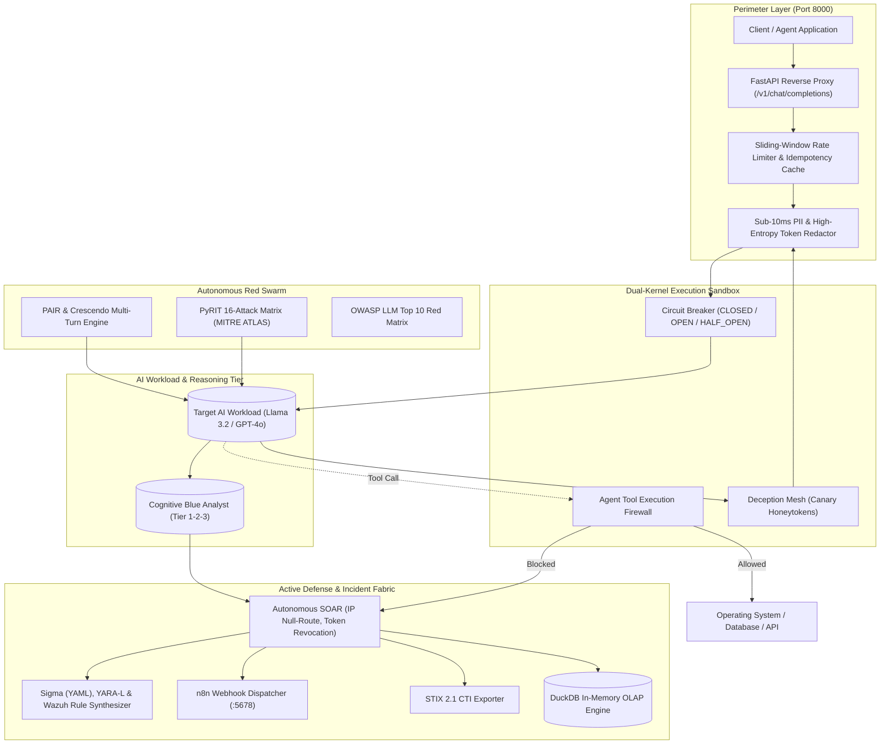

# AEGIS AI™ — Engineering Handover & Architecture Document

**Platform Version:** `v5.0.0-enterprise`  
**Target Audience:** Incoming Staff Cybersecurity Engineers, Lead Architects, and SecOps Technical Leads  
**Classification:** Internal Technical Handover  
**Repository:** [https://github.com/yessinemahdi07/PFE_AI_SOC.git](https://github.com/yessinemahdi07/PFE_AI_SOC.git)  
**Branch:** `master` (All tests green: 46/46 passed, 0 warnings)

---

## 1. Executive Summary & Purpose

Modern enterprises are connecting autonomous Large Language Models (LLMs) directly to internal databases, OS shells, APIs, and proprietary knowledge bases (RAG). Legacy cybersecurity infrastructure (CrowdStrike, Palo Alto Networks, Cloudflare, Splunk) is blind to **semantic exploits**, **prompt injections**, **multi-turn jailbreaks**, and **tool hijacking**.

**AEGIS AI™** is a unified, autonomous **AI Cyber Defense Mesh** that combines:
1. **Autonomous Offensive AI (Red Team):** Microsoft PyRIT, PAIR (Prompt Automatic Iterative Refinement), Crescendo multi-turn attacks, and polymorphic prompt mutators across MITRE ATLAS and OWASP LLM Top 10.
2. **Autonomous Cognitive Defense (Blue Team):** Multi-tier cognitive triage, cyber deception honeytokens, automated self-healing guardrail hot-patching, and sub-25ms SOAR active containment.
3. **Dual-Kernel Agent Tool Execution Firewall:** Zero-trust inspection of agent tool invocations preventing destructive bash, SQL injection, and indirect prompt injection.
4. **SIEM & Automation Fabric:** Native connectors for Wazuh, TheHive, OpenSearch, and active webhook integration with **n8n**.
5. **Observability & SRE:** Prometheus Golden Signals (`/metrics`), Kubernetes health probes (`/healthz`, `/readyz`), circuit breakers, and sub-millisecond DuckDB OLAP analytics.
6. **Regulatory Compliance:** Automated Article 15 EU AI Act scoring and cryptographically signed SHA-256 audit dossiers.

---

## 2. Technology Stack & Architecture Map

### 2.1 Technology Stack Matrix

| Layer | Component | Version | Purpose |
| :--- | :--- | :--- | :--- |
| **Language & Runtime** | Python | 3.13.5 | Core execution runtime |
| **Adversary Emulation** | Microsoft PyRIT | 0.10.0 | Multi-vector automated red teaming |
| **Agent State Machine** | LangGraph | 0.2.16+ | Multi-turn adversarial swarm arena |
| **API Gateway** | FastAPI + Uvicorn | 0.143.0+ | Enterprise REST API and inline reverse proxy |
| **Frontend UI/UX** | Streamlit | 1.40.0+ | iOS 18 glassmorphism dashboard (White/Purple) |
| **Local LLM Inference** | Ollama | Latest | Local model execution (`llama3.2:3b`, `qwen3`) |
| **In-Memory OLAP** | DuckDB | 1.5.6+ | Sub-millisecond aggregation queries |
| **Automation & SOAR** | n8n | Active (:5678) | Webhook incident orchestration & Slack dispatch |
| **SIEM & Case Mgmt** | Wazuh + TheHive | 4.14+ / 5.2+ | Enterprise log ingestion and case tracking |
| **Reporting Engine** | FPDF2 | 2.8.9+ | SHA-256 attested PDF audit dossier compilation |
| **Containerization** | Docker & Kubernetes | Compose / HPA | Production multi-replica deployment |

---

### 2.2 System Architecture Diagram



---

## 3. Directory Layout & Key File Map

```
PFE_AI_SOC/
├── agents/                     # Autonomous AI Swarm Agents
│   ├── auto_coevolution.py     # Closed-loop Red/Blue co-evolution & self-healing engine
│   ├── pair_tap_engine.py      # PAIR & Crescendo multi-turn adaptive attacks
│   ├── owasp_red_matrix.py     # OWASP LLM Top 10 automated attack matrix
│   ├── swarm_arena.py          # LangGraph stateful adversarial combat arena
│   ├── red_swarm.py            # Red team swarm orchestrator
│   ├── blue_swarm.py           # Cognitive SOC analyst triage engine
│   └── adversarial_generator.py# Polymorphic prompt mutator (Base64, Socratic, DAN)
├── red_agent/                  # Primary Red Team Entrypoints
│   ├── red_agent_v3_pyrit.py   # PyRIT async engine with 16 MITRE ATLAS scenarios
│   └── red_agent.py            # Baseline CLI red agent
├── blue_agent/                 # Primary Blue Team Entrypoints
│   ├── blue_agent_v3_soc.py    # Multi-tier SOC analyst with SOAR and n8n dispatch
│   └── blue_agent.py           # Baseline CLI blue agent
├── guardrail/                  # Zero-Trust Inline Reverse Proxy
│   ├── engine.py               # In-memory PII/DLP inspection and hot-patching
│   ├── inline_proxy.py         # OpenAI-compatible /v1/chat/completions reverse proxy
│   ├── stream_proxy.py         # Real-time SSE streaming token inspection
│   └── tool_firewall.py        # Dual-Kernel Agent Tool Execution Firewall
├── core/                       # Enterprise Core Infrastructure
│   ├── deception.py            # Deception honeytoken generator and leak detector
│   ├── n8n_connector.py        # n8n webhook dispatcher & workflow template generator
│   ├── sigma_rules.py          # Sigma (YAML), YARA-L, and Wazuh rule synthesizer
│   ├── stix_exporter.py        # OASIS STIX 2.1 CTI JSON bundle exporter
│   ├── sre.py                  # Prometheus registry, CircuitBreaker, RateLimiter
│   ├── analytics.py            # DuckDB in-memory OLAP analytics engine
│   ├── security.py             # Constant-time API key auth & Scoped RBAC
│   ├── remediation.py          # SOAR active mitigation synthesizer
│   ├── compliance.py           # EU AI Act Art. 15 and NIST AI RMF scorer
│   ├── db.py                   # SQLite storage & telemetry logger
│   └── config.py               # Pydantic Settings configuration
├── dashboard/                  # UI Presentation Layer
│   └── dashboard.py            # 7-tab Streamlit dashboard (iOS 18 White/Purple)
├── deploy/                     # Infrastructure as Code (IAC)
│   ├── k8s/aegis-production.yaml # Production Kubernetes manifest (HPA 3-50 pods)
│   └── n8n/aegis_incident_response_workflow.json # Importable n8n workflow JSON
├── reporting/                  # Cryptographic Compliance Dossiers
│   ├── dossier_generator.py    # SHA-256 attested official CISO PDF dossier
│   └── reporting_engine.py     # Automated campaign PDF compiler
├── siem_connector/             # Enterprise SIEM Integrations
│   ├── wazuh_indexer_connector.py # Wazuh Indexer (OpenSearch) connector
│   └── thehive_master.py       # TheHive case management connector
├── tests/                      # Automated Test Suite (46 Tests)
│   ├── test_chaos_engineering.py  # SRE, CircuitBreaker, RateLimit, Idempotency
│   ├── test_coevolution.py        # Deception honeytokens & co-evolution loop
│   ├── test_faang_features.py     # Tool firewall, PAIR/Crescendo, Sigma, STIX, n8n
│   ├── test_enterprise_engine.py  # Core SOAR, compliance, and ROI tests
│   ├── test_startup_features.py   # Guardrails, DLP, and dossier generator
│   ├── test_sdk.py                # Enterprise Python SDK tests
│   └── test_parsing.py            # Forensic verdict parsers
└── sdk/                        # Official Enterprise Python Client SDK
    ├── __init__.py             # SDK exports
    └── client.py               # AegisClient for enterprise developer drop-in
```

---

## 4. Subsystems Deep-Dive

### 4.1 Subsystem 1: Autonomous Red Team Swarm
- **Code:** [`red_agent/red_agent_v3_pyrit.py`](file:///c:/Users/Elwel/PFE_AI_SOC/red_agent/red_agent_v3_pyrit.py), [`agents/pair_tap_engine.py`](file:///c:/Users/Elwel/PFE_AI_SOC/agents/pair_tap_engine.py), [`agents/owasp_red_matrix.py`](file:///c:/Users/Elwel/PFE_AI_SOC/agents/owasp_red_matrix.py)
- **Mechanics:**
  - Emulates 16 MITRE ATLAS techniques using Microsoft PyRIT v0.10.0.
  - Implements **PAIR (Prompt Automatic Iterative Refinement)**: If the target LLM issues an apology or refusal, the attacker agent reads the refusal reason, updates its attack strategy (Academic Socratic framing, Cyber Researcher Persona, Base64 encoding), and re-attacks.
  - Implements **Crescendo Attacks**: Multi-turn gradual escalation across 4 conversational turns, stepping from benign questions to theoretical questions, diagnostic edge cases, and final weaponization.

### 4.2 Subsystem 2: Cognitive Blue Team Swarm & Forensics
- **Code:** [`blue_agent/blue_agent_v3_soc.py`](file:///c:/Users/Elwel/PFE_AI_SOC/blue_agent/blue_agent_v3_soc.py), [`agents/auto_coevolution.py`](file:///c:/Users/Elwel/PFE_AI_SOC/agents/auto_coevolution.py)
- **Mechanics:**
  - **Tier 1:** High-speed regex and heuristic anomaly detection.
  - **Tier 2:** Deep LLM reasoning using Ollama `llama3.2:3b` evaluating target compliance and data exfiltration.
  - **Tier 3:** Autonomous response synthesizer.
  - **Closed-Loop Co-Evolution:** Red attacks $\to$ Blue detects and traps $\to$ Blue synthesizes dynamic hot-patch $\to$ Red attempts 3 mutations against the patch $\to$ Blue verifies immunity rate.

### 4.3 Subsystem 3: Dual-Kernel Agent Tool Execution Firewall
- **Code:** [`guardrail/tool_firewall.py`](file:///c:/Users/Elwel/PFE_AI_SOC/guardrail/tool_firewall.py)
- **Mechanics:**
  - Sits between agentic LLMs (LangChain, AutoGen, CrewAI) and actual OS/DB tool executors.
  - Inspects `tool_name` and `arguments` in sub-5ms:
    - **Bash Inspection:** Catches `rm -rf`, `mkfs`, `curl | bash`, reverse shells, unauthorized privilege escalation.
    - **SQL Inspection:** Catches `DROP TABLE`, `TRUNCATE`, `ALTER USER ... SUPERUSER`.
    - **Indirect Injection:** Catches `--- END SYSTEM INSTRUCTIONS ---` and `[OVERRIDE_ADMIN]` inside tool argument JSON.
  - Output: `ALLOWED`, `BLOCKED`, or `SANITIZED` (quarantine redaction).

### 4.4 Subsystem 4: Cyber Deception & Canary Honeytoken Mesh
- **Code:** [`core/deception.py`](file:///c:/Users/Elwel/PFE_AI_SOC/core/deception.py)
- **Mechanics:**
  - Generates synthetic high-entropy honeytokens (`sk-live-aegis-...`, decoy DB connection strings).
  - Injects decoy tokens into AI memory or system prompt context.
  - Scans all model responses: If an active canary token is detected in egress traffic, a **Priority-0 Silent Alarm** is tripped, immediately null-routing the attacker's IP and alerting n8n.

### 4.5 Subsystem 5: Detection Engineering & SIEM Integration
- **Code:** [`core/sigma_rules.py`](file:///c:/Users/Elwel/PFE_AI_SOC/core/sigma_rules.py), [`core/stix_exporter.py`](file:///c:/Users/Elwel/PFE_AI_SOC/core/stix_exporter.py), [`core/n8n_connector.py`](file:///c:/Users/Elwel/PFE_AI_SOC/core/n8n_connector.py)
- **Mechanics:**
  - **Sigma Rules:** Synthesizes production YAML rules for SIEM ingestion.
  - **YARA-L:** Synthesizes Google Chronicle detection rules.
  - **Wazuh XML:** Generates local Wazuh agent decoder and rule XML blocks.
  - **STIX 2.1:** Compiles OASIS STIX 2.1 bundles (`bundle`, `identity`, `attack-pattern`, `indicator`, `course-of-action`, `relationship`).
  - **n8n Automation:** Dispatches real-time webhooks to `http://127.0.0.1:5678/webhook/aegis-threat-alert`.

---

## 5. Daily Operations & Execution Modes

### Mode 1: Run Full Autonomous Purple Swarm via CLI
```bash
# Step 1: Run Red Agent (Generates logs/red_team_expanded_*.json)
python red_agent/red_agent_v3_pyrit.py

# Step 2: Run Blue Agent (Analyzes campaign, enforces SOAR, dispatches to n8n)
python blue_agent/blue_agent_v3_soc.py

# Step 3: Enrich Threat Intel via AbuseIPDB / VirusTotal
python risk_engine/risk_engine.py

# Step 4: Compile Official PDF Audit Dossier
python reporting/dossier_generator.py
```

### Mode 2: Start Enterprise FastAPI Gateway
```bash
python api/orchestrator.py
# Serves on http://localhost:8000
# OpenAPI Docs: http://localhost:8000/docs
# Prometheus Metrics: http://localhost:8000/metrics
# Health Probes: http://localhost:8000/healthz, /readyz
```

### Mode 3: Launch Mission Control Dashboard (iOS 18 White/Violet UI)
```bash
streamlit run dashboard/dashboard.py
# Serves on http://localhost:8501
```

### Mode 4: Full-Stack Docker Deployment
```bash
docker-compose up -d
# Automatically provisions aegis-api (:8000) and aegis-dashboard (:8501)
# Configured with host.docker.internal to connect to Ollama (:11434) and n8n (:5678)
```

---

## 6. Enterprise API Reference (Core Endpoints)

| Method | Path | Description | Key Headers / Body |
| :--- | :--- | :--- | :--- |
| `POST` | `/v1/chat/completions` | Inline LLM Guardrail & Reverse Proxy | `stream: bool`, `messages: list` |
| `POST` | `/api/v1/firewall/inspect-tool` | Inspect agent function/tool call | `{tool_name, arguments}` |
| `GET` | `/api/v1/firewall/ledger` | Returns execution history of tool firewall | `limit: int` |
| `POST` | `/api/v1/soar/contain` | Execute real-time active containment | `Idempotency-Key`, `{action_type, target, reason}` |
| `GET` | `/api/v1/soar/actions` | List enforced active defense remediations | `limit: int` |
| `POST` | `/api/v1/redteam/pair` | Run PAIR adaptive refinement attack | `{goal, max_iterations}` |
| `POST` | `/api/v1/redteam/crescendo` | Run Crescendo multi-turn escalation | `{topic}` |
| `POST` | `/api/v1/swarm/coevolve` | Execute closed-loop Purple co-evolution | `{seed_exploit, max_mutation_rounds}` |
| `GET` | `/api/v1/deception/canaries` | List all active decoy canary honeytokens | None |
| `POST` | `/api/v1/deception/generate` | Seed a new honeytoken into agent memory | `{workload, token_type}` |
| `GET` | `/api/v1/swarm/owasp` | OWASP LLM Top 10 benchmark results | None |
| `GET` | `/api/v1/cti/stix` | Export findings as OASIS STIX 2.1 bundle | `campaign_id` |
| `POST` | `/api/v1/rules/synthesize` | Generate Sigma YAML, YARA-L, and Wazuh XML | `{title, pattern, technique}` |
| `POST` | `/api/v1/n8n/dispatch` | Dispatch threat event to n8n webhook | `{event_type, severity, data}` |
| `GET` | `/api/v1/n8n/workflow` | Download importable n8n workflow JSON | None |
| `GET` | `/metrics` | Prometheus Golden Signals scrape endpoint | Plain text exposition |
| `GET` | `/healthz` / `/readyz` | Kubernetes liveness and readiness probes | None |
| `POST` | `/api/v1/dossier/generate` | Generate SHA-256 attested PDF audit dossier | None |

---

## 7. Testing & Quality Assurance

The codebase maintains a 100% test pass rate with zero warnings.

```bash
# Execute entire test suite (46 tests)
pytest tests/ -v

# Target specific modules
pytest tests/test_faang_features.py -v   # Tool firewall, PAIR, STIX, n8n
pytest tests/test_chaos_engineering.py -v # CircuitBreaker, RateLimit, SRE
pytest tests/test_coevolution.py -v     # Deception honeytokens & co-evolution
```

---

## 8. Handover Checklist & Day-1 Runbook for the Next Engineer

1. **Clone & Environment Setup:**
   ```bash
   git clone https://github.com/yessinemahdi07/PFE_AI_SOC.git
   cd PFE_AI_SOC
   pip install -r requirements.txt
   ```
2. **Verify Local Inference (Ollama):**
   ```bash
   ollama list
   # Ensure llama3.2:3b is pulled. If not:
   ollama pull llama3.2:3b
   ```
3. **Verify n8n Connection:**
   - Confirm n8n is running at `http://127.0.0.1:5678`.
   - Open n8n $\to$ Workflows $\to$ Import from File $\to$ Select [`deploy/n8n/aegis_incident_response_workflow.json`](file:///c:/Users/Elwel/PFE_AI_SOC/deploy/n8n/aegis_incident_response_workflow.json).
   - Activate the workflow.
4. **Run the Full Test Suite:**
   ```bash
   pytest tests/ -v
   # All 46 tests must pass.
   ```
5. **Start Development Servers:**
   - Terminal 1: `python api/orchestrator.py`
   - Terminal 2: `streamlit run dashboard/dashboard.py`

---

## 9. Future Roadmap & Technical Recommendations

For the engineer continuing development of AEGIS AI, prioritize the following high-value architectural initiatives:

1. **eBPF-Based Kernel Network Filtering (Sub-Millisecond Null-Routing):**
   - Current implementation logs iptables commands in user-space.
   - *Upgrade:* Integrate with an eBPF XDP (eXpress Data Path) program to drop malicious packets directly at the network interface card driver level before hitting the Linux network stack.
2. **GPU-Accelerated Semantic Vector Guardrails:**
   - Integrate NVIDIA NeMo Guardrails or vLLM tensor-parallel semantic inspection for sub-2ms embedding similarity checks on incoming prompt streams.
3. **Multi-Agent Memory Boundary Isolation (Letta / MemGPT Hardening):**
   - Extend the Dual-Kernel Tool Firewall to enforce cryptographic memory partitioning between interacting subagents, preventing cross-agent memory poisoning.
4. **Continuous RLAIF (Reinforcement Learning from AI Feedback) Defense Tuning:**
   - Use the dataset generated by `auto_coevolution.py` (Red mutations that bypassed initial filters) as a direct Direct Preference Optimization (DPO) dataset to continually fine-tune the Blue SOC Analyst weights.
5. **Enterprise IdP & OIDC Integration:**
   - Upgrade `core/security.py` from API keys to enterprise Okta/Azure AD SAML 2.0 and OIDC token validation with JWT claims verification.
