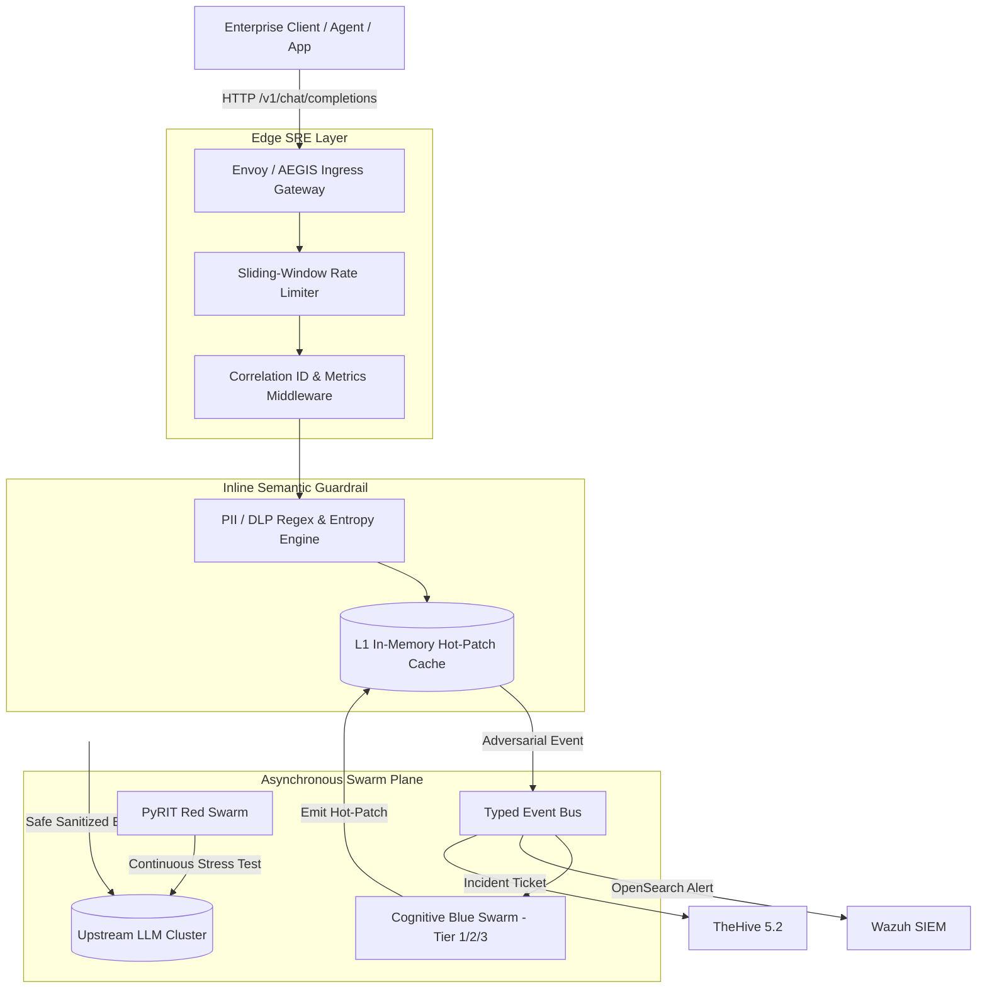

# 📄 RFC-2026-088: AEGIS AI Cognitive Cyber Defense Mesh
### **System Architecture & Scalability Design Document**
**Author:** Staff Software Engineer / Lead Technical Program Manager (SecOps Platform)  
**Status:** APPROVED / IN-PRODUCTION  
**Target SLA / SLO:** 99.95% Availability | P99 Latency < 15ms | Sub-25ms SOAR Containment  

---

## 1. Context & Business Problem
Enterprise organizations are rapidly integrating autonomous LLM agents and multi-agent swarms into core operational workflows (database queries, code generation, financial reconciliation). 

Traditional EDR/SIEM tools monitor OS syscalls and network packets—**they are semantically blind to adversarial prompt manipulation, data leakage, and tool hijacking.**

AEGIS AI provides an inline, zero-latency semantic guardrail proxy combined with an autonomous purple-teaming feedback loop to achieve continuous zero-day immunity.

---

## 2. Goals & Non-Goals

### Goals
- **G1 (Sub-10ms Inline Inspection):** Inspect prompts for PII/DLP violations and jailbreak patterns with a P99 latency budget $\le 15\text{ms}$ and P50 $\le 3\text{ms}$.
- **G2 (Closed-Loop Autonomous Immunity):** Automatically synthesize and hot-patch guardrail rules when the Blue Swarm identifies a novel attack vector.
- **G3 (High Availability & Scalability):** Support horizontal scale-out to $100\text{M}+$ daily token transactions with graceful circuit-breaking and rate-limiting.
- **G4 (Audit Attestation):** Provide verifiable cryptographic audit trails compliant with EU AI Act Article 15 and NIST AI RMF 1.0.

### Non-Goals
- **NG1 (Model Training):** AEGIS does not pre-train foundation models; it acts as a runtime immune system, proxy, and adversary emulator.
- **NG2 (Static Storage):** AEGIS is not a general-purpose SIEM data lake; it streams enriched telemetry into existing enterprise SIEMs (Wazuh, Splunk, OpenSearch).

---

## 3. High-Level Architecture (C4 Model)

---

## 4. SRE SLOs & Latency Budget

| Metric | Target SLO | Monitoring Mechanism | Alerting Threshold |
|---|---|---|---|
| **Service Availability** | **99.95%** | Prometheus `/metrics` | P0 if $< 99.90\%$ over 5m |
| **P50 Guardrail Latency** | **$\le 2.5\text{ms}$** | Histogram `aegis_http_request_duration` | P1 if $> 5.0\text{ms}$ |
| **P99 Guardrail Latency** | **$\le 15.0\text{ms}$** | Histogram `aegis_http_request_duration` | P1 if $> 20.0\text{ms}$ |
| **SOAR Mean Time to Contain (MTTC)** | **$\le 50.0\text{ms}$** | Active Remediation Ledger | P2 if $> 100.0\text{ms}$ |

---

## 5. Threat Modeling (STRIDE Analysis)

1. **Spoofing (S):** Addressed via API token authentication, mTLS between microservices, and HMAC-SHA256 signatures on outbound webhooks.
2. **Tampering (T):** Addressed via SHA-256 cryptographic audit hashing on CISO dossiers and immutable append-only SQLite/OpenSearch telemetry logs.
3. **Repudiation (R):** Every request is tagged with an immutable `X-Correlation-ID` propagated through distributed contextvars.
4. **Information Disclosure (I):** Zero-latency regex and heuristic PII masking strips SSNs, credit cards, and private API keys before upstream inference.
5. **Denial of Service (D):** Sliding-window token bucket rate limiter drops abusive clients with HTTP 429 and `Retry-After` headers.
6. **Elevation of Privilege (E):** Tool Hijacking prevention quarantines rogue LLM function calls attempting unauthorized shell or database execution.

---

## 6. Failure Modes & Circuit Breaking
- **Upstream LLM Outage:** Circuit Breaker trips to `OPEN` after 3 consecutive connection timeouts. Fast-fails with cached fallback or structured refusal in $< 2\text{ms}$, preventing connection pool starvation.
- **Wazuh / TheHive Disconnection:** High-speed buffer queue captures alerts in-memory/SQLite without blocking client request threads.
